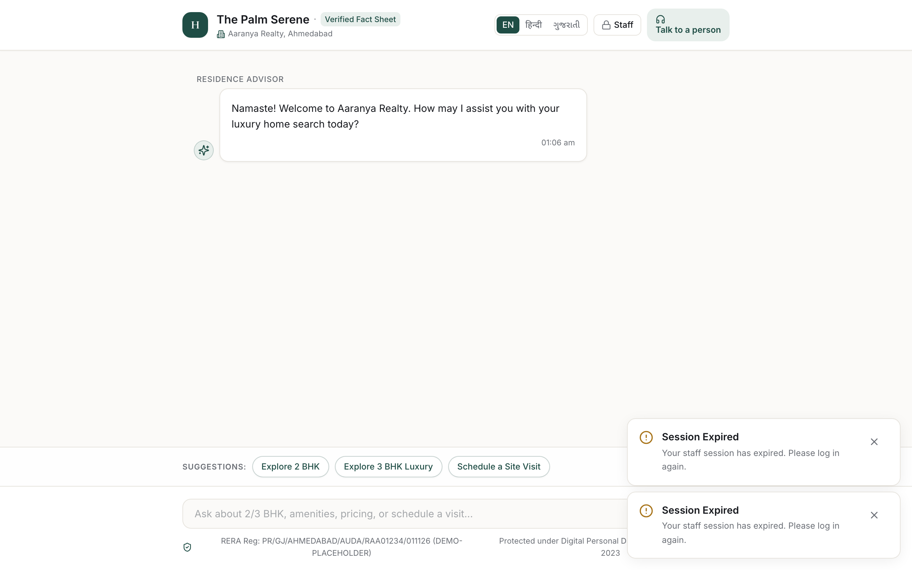
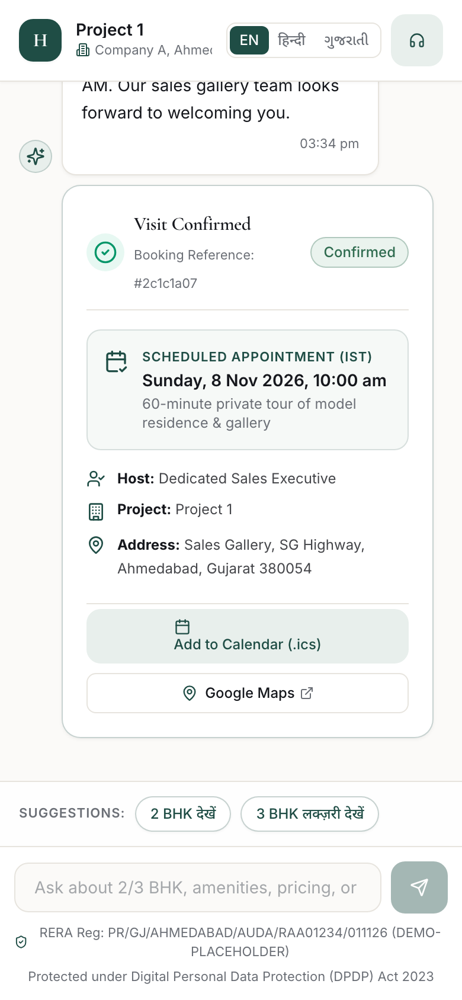
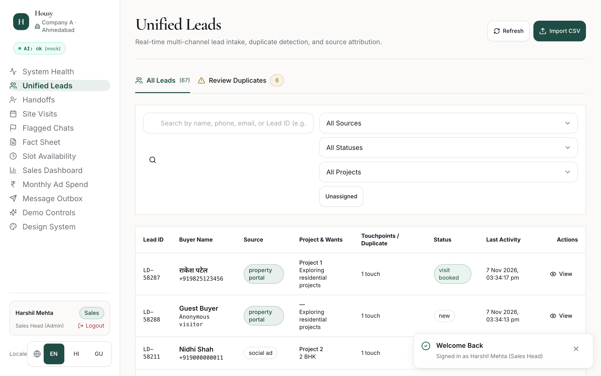
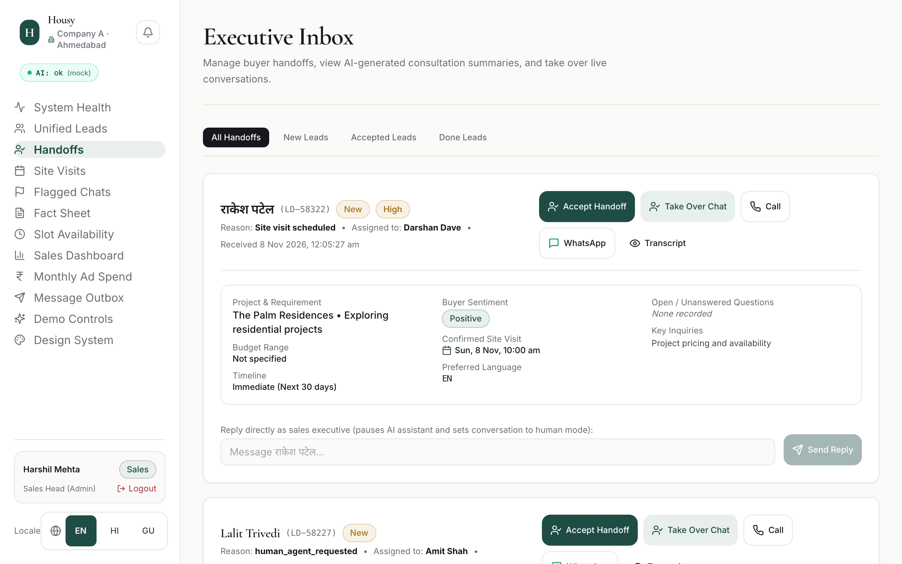
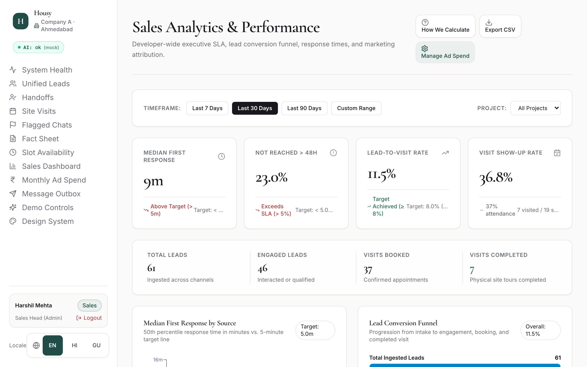
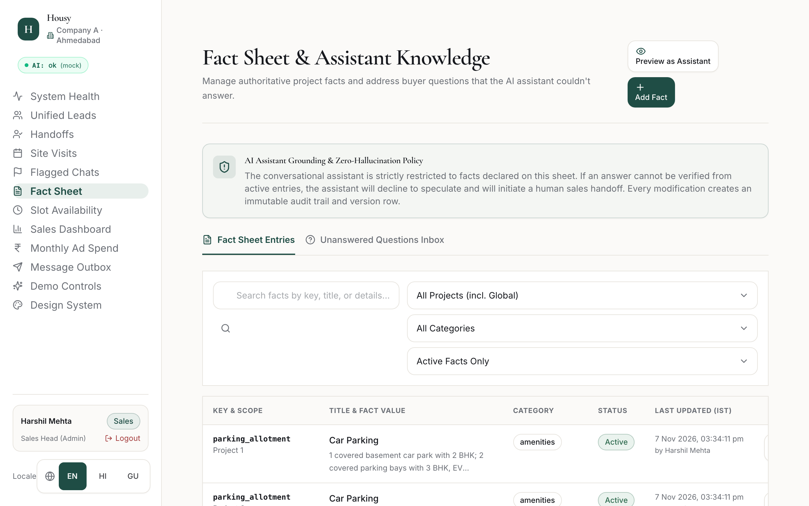

# Housy — AI Sales & Site-Visit Booking Platform

[](https://github.com/satwikmishra11/Housy-/actions/workflows/ci.yml)
[](https://www.typescriptlang.org/)
[](LICENSE)
[]()

> Full-stack AI conversational sales assistant and conflict-free site-visit booking platform built for residential real estate developers in Ahmedabad, Gujarat (Project 1 & Project 2, ₹65L – ₹1.2 Cr). Solves lead wastage and slow response times by guaranteeing 24/7 sub-2-minute replies in English, Hindi, and Gujarati, booking real free slots with zero double-booking, and orchestrating warm handoffs to sales executives.

- 🌐 **Live Web Application**: [https://housy-ebon.vercel.app/](https://housy-ebon.vercel.app/)
- 📐 **Technical Design Document (TDD)**: [`docs/TDD.md`](./docs/TDD.md) | [Exported PDF](./docs/TDD.pdf)
- 📖 **Deployment Guide**: [`deployment.md`](./deployment.md)
- 📦 **Submission Package**: Downloadable as a release asset under [GitHub Releases](https://github.com/satwikmishra11/Housy-/releases)

---

## Screen Highlights

| Multilingual Buyer Advisory | Slot Booking & Map Pin Confirmation |
| :---: | :---: |
|  |  |

| Unified Lead Intake & Deduplication | Executive Handoff & AI Summary |
| :---: | :---: |
|  |  |

| Sales Performance & Source Analytics | Fact Sheet Knowledge Base Editor |
| :---: | :---: |
|  |  |

---

## 5-Command Quickstart

Get a complete local development environment running against PostgreSQL in 5 commands:

```bash
git clone https://github.com/satwikmishra11/Housy-.git && cd Housy-
npm install
cp apps/api/.env.example apps/api/.env
npm run db:test:reset
npm run dev
```

The API backend starts on `http://localhost:3001` and the React frontend on `http://localhost:5173` (with `/api` requests proxied to the backend).

### Quick Demo Accounts
| Role | Email | Password | Scope |
|---|---|---|---|
| **Sales Head (Admin)** | `harshil.mehta@example.com` | `DemoPass123!` | Developer-wide analytics, fact sheet editor, slot rules, ad spend |
| **Sales Executive** | `amit.shah@example.com` | `DemoPass123!` | Assigned lead triage, executive handoff inbox, visit outcome verification |

---

## Verification & Test Commands

```bash
# Run full verification suite (lint + typecheck + unit/integration tests)
npm run check

# Run Playwright End-to-End user journeys (headless Chromium)
npm run test:e2e

# Run automated secret scanner across working tree and git history
npm run scan:secrets
```

---

## Core Capabilities

1. **24/7 Multilingual AI Advisory**: Converses in English, Hindi, and Gujarati, strictly grounded in the sales head's active fact sheet. Hallucinations and unauthorized claims are eliminated by deterministic pre- and post-check guardrails.
2. **Zero Double-Booking Guarantee**: Pessimistic row-level locking (`SELECT ... FOR UPDATE SKIP LOCKED`) combined with PostgreSQL partial unique constraints (`UNIQUE(slot_id) WHERE status = 'confirmed'`) ensures concurrent buyers can never book the same slot.
3. **Automated Deduplication Pipeline**: Exact phone/email normalization and PostgreSQL trigram matching (`pg_trgm`) deduplicate incoming leads across property portals, Meta ads, website forms, and offline hoardings.
4. **DPDP Act 2023 & RERA Compliance**: Strict affirmative consent notices, immediate opt-out halting on `STOP` or cancellation, and statutory Gujarat AUDA RERA registration numbers embedded on all touchpoints.
5. **Executive Analytics Dashboard**: Real-time tracking of first response latency (median target < 5 min), 48h SLA breach %, show-up rates, and prorated cost-per-completed-visit by acquisition source.

---

## Honest Limitations & Boundaries

To ensure complete transparency regarding scope:

- **CRM Scope**: Designed as an agile sales acceleration slice (intake, qualification, booking, handoff, analytics), not a full ERP or CRM replacement. Does not handle token money collection, booking payments, or flat allotment letters.
- **Telephony & Outbound Voice**: Voice calling is not implemented; contact numbers are surfaced as one-tap `tel:` and `wa.me` links for executive outreach.
- **Messaging Adapters**: WhatsApp, SMS, and Email pipelines use an asynchronous outbox pattern (`outbound_messages`). In local/CI environments, mock adapters log dispatches; live external dispatch requires provider credentials (e.g. Meta Cloud API or Twilio).
- **LLM Keys**: In development and CI, the test suite executes deterministically against `LLM_PROVIDER=mock`. Live production deployment requires an Anthropic or Google Gemini API key.
- **Operating Hours**: Site visits run 10:00–18:00 IST in 60-minute intervals with a minimum 3-hour advance booking lead time.

---

## Documentation

Detailed technical documentation is available in `docs/`:

- **[System Architecture](docs/ARCHITECTURE.md)**: 3-tier structure, layering, error codes, authentication, and frontend design tokens.
- **[Data Model & Constraints](docs/DATA_MODEL.md)**: 19 PostgreSQL tables, ER diagram, partial unique indexes, and Migration 005 performance indexing.
- **[AI Pipeline & Guardrails](docs/AI_PIPELINE.md)**: Autonomous agent loop, tool schemas, multilingual regex pre-filters, failure mitigations, and evals.
- **[Operations & Deployment](docs/OPERATIONS.md)**: Vercel multi-service project (`vercel.json`), serverless runtime, background reminder workers, and outbox.
- **[Assumptions Log](docs/ASSUMPTIONS.md)**: Product, architectural, and regulatory assumptions log (`A1`–`A60`).
- **[Hardening & Security](docs/HARDENING.md)**: Rate limiting benchmarks, CSRF/CSP protections, secret scanning, and WCAG AA audits.
- **[AI Evaluation Suite](docs/AI_EVALS.md)**: 48-case benchmark verifying fact grounding, prompt injection resistance, and multilingual fidelity.
