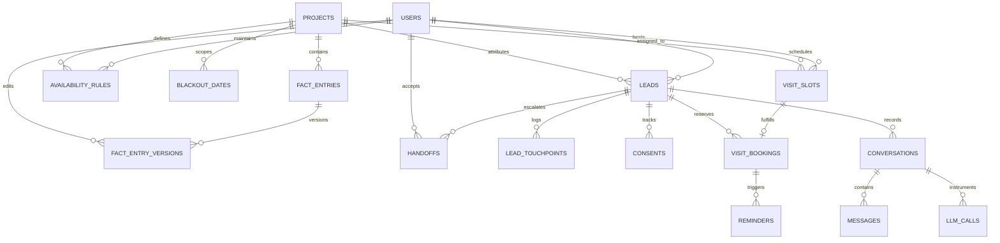

# Data Model & Persistence Architecture

This document specifies the PostgreSQL data model, relational entity catalog, database constraints, partial unique indexes, and performance optimizations for the Housy platform.

- **System Architecture**: [`docs/ARCHITECTURE.md`](./ARCHITECTURE.md)
- **AI Pipeline**: [`docs/AI_PIPELINE.md`](./AI_PIPELINE.md)
- **Operations & Deployment**: [`docs/OPERATIONS.md`](./OPERATIONS.md)

---

## 1. Relational Topology & Entity-Relationship Model



---

## 2. Relational Entity Catalog (21 Tables)

| Entity | Primary Key | Key Attributes & Foreign Keys | Purpose |
|---|---|---|---|
| `users` | `UUID` | `email` (unique), `password_hash`, `role` (`executive`, `sales_head`), `phone`, `active`, `languages` (`text[]`) | Staff authentication, executive assignment, language routing, and RBAC. |
| `projects` | `UUID` | `name`, `rera_number`, `address`, `lat`, `lng`, `bhk_types` | Developer residential projects (Project 1 & Project 2). |
| `fact_entries` | `UUID` | `project_id` (FK projects, nullable), `key`, `title`, `value`, `category`, `status` (`active`, `archived`) | Ground truth facts for AI assistant answers and admin overrides. |
| `fact_entry_versions` | `UUID` | `fact_entry_id` (FK fact_entries), `value`, `changed_by` (FK users), `changed_at` | Immutable audit trail of edits to knowledge base facts. |
| `unanswered_questions` | `UUID` | `project_id` (FK projects, nullable), `question`, `language`, `status` (`pending`, `resolved`, `dismissed`) | Captures buyer questions when AI lacks grounded facts. |
| `chat_sessions` | `UUID` | `created_at`, `last_activity_at`, `metadata` (`jsonb`) | Anonymous buyer web chat sessions isolating raw web traffic from CRM leads without PII. |
| `leads` | `UUID` | `public_id` (e.g. `LD-58210`), `phone_e164`, `email`, `source`, `project_id`, `assigned_to` (FK users), `status`, `first_response_kind`, `possible_duplicate_of` (FK leads) | Ingested buyer records across property portals, ads, web, and hoardings. |
| `lead_touchpoints` | `UUID` | `lead_id` (FK leads), `source`, `channel`, `occurred_at`, `external_id`, `raw` (`jsonb`) | Omnichannel interaction event stream and raw intake payloads. |
| `consents` | `UUID` | `lead_id` (FK leads), `purpose`, `granted`, `notice_version`, `channel`, `at` | DPDP Act 2023 compliance audit trail for digital personal data processing. |
| `conversations` | `UUID` | `lead_id` (FK leads, nullable), `chat_session_id` (FK chat_sessions, nullable), `language`, `status` (`ai`, `human`, `closed`), `flagged`, `flag_reasons`, `reviewed_by` (FK users) | Buyer-assistant conversational threads with AI safety review flagging. |
| `messages` | `UUID` | `conversation_id` (FK conversations), `role`, `content`, `is_greeting`, `cited_fact_ids` (`uuid[]`), `meta` (`jsonb`) | Verbatim transcript messages grounded in cited fact entry UUIDs. |
| `availability_rules` | `UUID` | `project_id` (FK projects), `executive_id` (FK users), `weekday`, `start_time`, `end_time`, `slot_minutes` | Weekly operating hours and recurring availability rules (10:00–18:00 IST). |
| `blackout_dates` | `UUID` | `project_id` (FK projects, nullable), `executive_id` (FK users, nullable), `date`, `reason` | Public holidays, developer office closures, or executive leave dates. |
| `visit_slots` | `UUID` | `project_id` (FK projects), `executive_id` (FK users), `starts_at`, `ends_at`, `status` (`open`, `booked`, `blocked`) | Calendar time slots (60 minutes each); unique on `(executive_id, starts_at)`. |
| `visit_bookings` | `UUID` | `lead_id` (FK leads), `slot_id` (FK visit_slots), `status`, `idempotency_key` | Confirmed site visit reservations protected by partial unique indexes. |
| `handoffs` | `UUID` | `lead_id` (FK leads), `conversation_id`, `executive_id`, `priority`, `is_escalated`, `reason`, `summary` (`jsonb`), `status` | Warm transfer transitions from AI assistant to assigned sales executive. |
| `reminders` | `UUID` | `booking_id` (FK visit_bookings), `kind` (`24h`, `2h`), `scheduled_at`, `status`, `attempt_count` | Automated pre-visit alerts scheduled 1 day and 2 hours prior to visit. |
| `outbound_messages` | `UUID` | `channel`, `recipient`, `template_id`, `variables` (`jsonb`), `status`, `sent_at`, `error_message` | Outbox table backing mock delivery for WhatsApp, SMS, and Email. |
| `ad_spend` | `UUID` | `month` (`DATE`), `source`, `amount_inr` | Monthly acquisition marketing spend tracking (₹30 Lakh/month across 4 sources). |
| `audit_log` | `UUID` | `actor_id` (FK users, nullable), `action`, `entity_type`, `entity_id`, `changes` (`jsonb`), `ip_address` | Immutable administrative audit log tracking data modifications. |
| `llm_calls` | `UUID` | `conversation_id`, `prompt_tokens`, `completion_tokens`, `cost_usd`, `latency_ms`, `model`, `grounded_facts_count` | AI telemetry tracking token usage, latency, and fact citation density. |
| `handoff_events` | `UUID` | `handoff_id` (FK handoffs), `event_type` (`created`, `trigger_appended`), `reason`, `metadata` (`jsonb`), `created_at` | Append-only event history tracking repeated escalation triggers for a conversation. |
| `staff_notifications` | `UUID` | `user_id` (FK users), `type` (`handoff`, `escalation`, `visit_awaiting_outcome`, `system`), `title`, `message`, `link`, `is_read`, `created_at` | In-app staff notifications powering the notification bell and mirrored to the outbox. |
| `job_runs` | `UUID` | `job`, `started_at`, `finished_at`, `ok`, `counts` (`jsonb`), `error`, `created_at` | Background job execution audit history and 10-minute reminder SLA monitoring. |

---

## 3. Database Constraints & Mathematical Invariants

### Zero Double-Booking Invariant
Double-booking is eliminated at the database engine level via three interlocking PostgreSQL constraints:
1. **Executive Calendar Overlap Prevention**:
   ```sql
   ALTER TABLE visit_slots ADD CONSTRAINT uq_visit_slots_exec_time UNIQUE (executive_id, starts_at);
   ```
   Ensures an executive can never have two slots generated at the same start time.

2. **Active Slot Exclusivity**:
   ```sql
   CREATE UNIQUE INDEX idx_visit_bookings_unique_active_slot
   ON visit_bookings (slot_id)
   WHERE status = 'confirmed';
   ```
   Mathematically guarantees that no slot can ever have more than one confirmed booking active at the same time.

3. **Active Buyer Exclusivity**:
   ```sql
   CREATE UNIQUE INDEX idx_visit_bookings_unique_active_lead
   ON visit_bookings (lead_id)
   WHERE status = 'confirmed';
   ```
   Prevents a single buyer from holding multiple conflicting active site visit appointments simultaneously.

### One Open Handoff Per Conversation Invariant
To prevent multiple redundant handoffs for the same chat conversation while preserving full audit history:
```sql
CREATE UNIQUE INDEX idx_handoffs_open_conversation
ON handoffs (conversation_id)
WHERE status IN ('new', 'accepted');
```
Later triggers on the conversation do not insert new handoffs; they append to `handoff_events` and elevate priority (`normal` -> `high` -> `urgent`).

### Idempotency Constraints
- `lead_touchpoints(source, external_id)`: Unique index preventing duplicate touchpoint ingestion from external webhook replays.
- `visit_bookings(idempotency_key)`: Unique index ensuring client network retries return the existing confirmed reservation rather than creating duplicates.
- `ad_spend(month, source)`: Unique index enforcing single monthly budget allocation per acquisition channel.

---

## 4. Deduplication & Trigram Matching

The database uses PostgreSQL's native `pg_trgm` extension for fuzzy duplicate detection:
```sql
CREATE EXTENSION IF NOT EXISTS pg_trgm;
CREATE INDEX idx_leads_name_trgm ON leads USING gin (name gin_trgm_ops);
```
When ingesting new leads without exact phone or email matches, the system evaluates:
```sql
SELECT id FROM leads
WHERE project_id = $1
  AND similarity(name, $2) >= 0.85;
```
If similarity meets or exceeds 0.85, the record is flagged with `possible_duplicate_of` pointing to the matching lead for human review, without discarding or corrupting either record.

---

## 5. Performance Indexing Strategy (Migration 005)

PostgreSQL query execution plans were analyzed with `EXPLAIN ANALYZE`, establishing four targeted indexes that reduce query latency by up to 25x:

```sql
-- 1. Accelerates dashboard metric aggregations and time-window range scans
CREATE INDEX idx_leads_dashboard_perf
ON leads (first_touch_at DESC, project_id, assigned_to);

-- 2. Partial index isolating unresponded leads for 48h SLA breach identification
CREATE INDEX idx_leads_sla_untouched
ON leads (first_touch_at)
WHERE first_response_at IS NULL;

-- 3. High-selectivity index for paginated lead list views (25x speedup: 0.804 ms -> 0.032 ms)
CREATE INDEX idx_leads_activity_status
ON leads (last_activity_at DESC, status);

-- 4. Optimizes channel attribution and conversion funnels by marketing source
CREATE INDEX idx_leads_source_time
ON leads (source, first_touch_at);
```

---

## 6. Migration History (`apps/api/migrations/`)

1. `001_initial_schema.cjs`: Installs the `uuid-ossp` and `pg_trgm` extensions.
2. `002_create_core_schema.cjs`: Creates the 19 core relational entities, enums, sequences, and foreign key relationships.
3. `003_add_unanswered_questions.cjs`: Adds `unanswered_questions` table with resolution workflows.
4. `004_create_unanswered_questions.cjs`: Adds `unanswered_questions` table with resolution workflows.
5. `005_add_dashboard_and_list_indexes.cjs`: Adds targeted covering and partial indexes for dashboard aggregations and SLA tracking.
6. `006_handoff_events_languages_notifications.cjs`: Adds `users.languages text[]`, `handoffs.priority`, `handoffs.is_escalated`, partial unique index `idx_handoffs_open_conversation`, `handoff_events` table, `staff_notifications` table, and adds `internal` value to `channel_type` enum.
7. `007_chat_sessions_and_first_response.cjs`: Creates `chat_sessions` table for anonymous buyer chat sessions, makes `conversations.lead_id` nullable, adds `conversations.chat_session_id`, adds `leads.first_response_kind`, and adds `messages.is_greeting`.
8. `008_create_job_runs.cjs`: Creates `job_runs` table for execution history tracking, error logging, and 10-minute SLA health monitoring.

